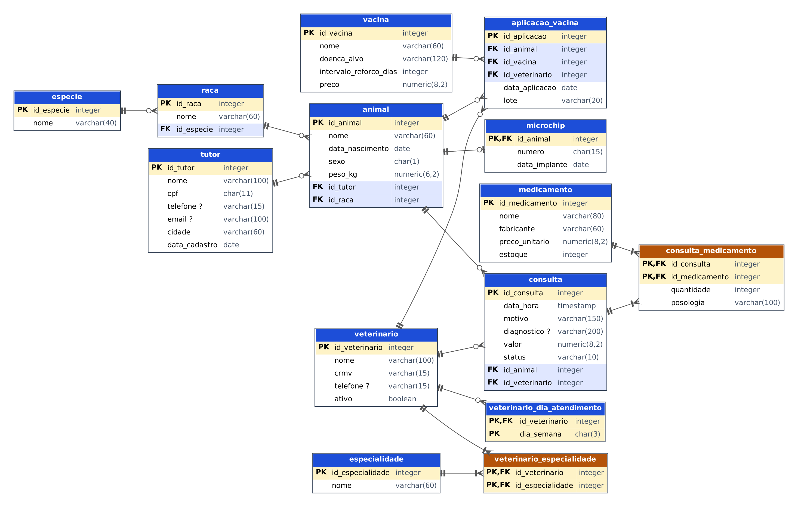

# PetVida — Banco de Dados de uma Clínica Veterinária e Pet Shop

**Atividade III — SEDUC DEST2:** planejar, criar e testar um banco de dados relacional.

> **SGBD utilizado:** PostgreSQL 16. Todos os scripts deste repositório foram executados e testados
> (criação, população, as 15 consultas e a restauração do dump) em um servidor PostgreSQL 16.
> Os resultados mostrados na seção 6 são a saída real dessas execuções.

## Sumário

1. [Domínio](#1-domínio-do-banco-de-dados)
2. [Contextualização](#2-contextualização)
3. [Proposta de melhoria](#3-proposta-de-melhoria)
4. [Modelagem lógica](#4-modelagem-lógica)
5. [Normalização (1FN a 4FN)](#5-normalização-1fn-2fn-3fn-e-4fn)
6. [Instruções SQL](#6-instruções-sql)
7. [Como fazer o dump](#7-passo-a-passo-do-dump-estrutura-e-dados)
8. [Como comitar](#8-como-comitar-no-repositório)
9. [Entrega no Classroom](#9-entrega-no-classroom)

## Estrutura do repositório

```text
petvida/
├── README.md                    <- este documento
├── docs/
│   ├── modelagem.png            <- print da modelagem (diagrama ER)
│   └── modelagem.svg
├── sql/
│   ├── 01_criar_banco.sql       <- cria o banco de dados
│   ├── 02_criar_tabelas.sql     <- cria as 14 tabelas
│   ├── 03_popular_tabelas.sql   <- insere os dados (mín. 5 por tabela)
│   └── 04_consultas.sql         <- 15 consultas contextualizadas
└── dump/
    ├── petvida_completo.sql     <- estrutura + dados (gerado com pg_dump)
    ├── petvida_estrutura.sql    <- somente estrutura
    └── petvida_dados.sql        <- somente dados
```

---

## 1. Domínio do Banco de Dados

**Clínica veterinária e pet shop (PetVida).** O banco registra tutores, animais, veterinários,
consultas, medicamentos prescritos, estoque de medicamentos e o histórico de vacinação.

## 2. Contextualização

A **PetVida** é uma clínica veterinária de bairro, com pet shop, que atende cães, gatos, coelhos,
aves e pequenos roedores. A equipe tem 5 veterinários de diferentes especialidades (clínica geral,
cardiologia, dermatologia, ortopedia e animais exóticos) e uma recepção que agenda os atendimentos.

Hoje, **sem um SGBD relacional**, os dados vivem em fichas de papel, planilhas soltas e no caderno
de agendamentos. Isso gera problemas concretos:

- **Redundância e inconsistência:** o telefone de um tutor com três animais é digitado em três fichas;
  quando ele muda, algumas fichas ficam desatualizadas.
- **Dados não atômicos:** na planilha, uma célula guarda "V10, Antirrábica" ou vários medicamentos
  separados por vírgula, o que impede contar, filtrar ou somar.
- **Sem integridade:** nada impede cadastrar uma consulta para um animal inexistente, um peso negativo
  ou um mesmo CRMV para dois veterinários.
- **Consultas lentas e manuais:** responder "quanto cada veterinário faturou no mês?" ou "quais animais
  nunca foram vacinados?" exige abrir fichas uma a uma ou refazer contas à mão.
- **Controle de estoque falho:** a falta de um medicamento só é percebida quando ele acaba.
- **Lembretes de vacina perdidos:** o reforço anual depende da memória da recepção.
- **Concorrência e segurança:** duas pessoas editando a mesma planilha sobrescrevem o trabalho uma da
  outra; não há controle de acesso nem cópia de segurança confiável, e uma planilha corrompida pode
  significar perda do histórico clínico.

## 3. Proposta de melhoria

Implantar um **banco de dados relacional (PostgreSQL)** modelado em 14 tabelas normalizadas até a 4FN.
O SGBD passa a garantir:

| Problema atual | Solução com SGBD relacional |
|---|---|
| Dados repetidos | Cada informação é gravada uma única vez e referenciada por chave estrangeira |
| Dados inválidos | Chaves primárias, `UNIQUE`, `NOT NULL`, `CHECK` e chaves estrangeiras |
| Relatórios manuais | Consultas SQL (`JOIN`, `GROUP BY`, `SUM`...) respondem em segundos |
| Estoque sem controle | Tabela `medicamento` com `estoque` e consulta de alerta de estoque baixo |
| Reforço de vacina esquecido | Tabela `aplicacao_vacina` + `intervalo_reforco_dias` permitem listar vencimentos |
| Edição simultânea | Controle de concorrência e transações do SGBD |
| Perda de dados | Backup/restauração por `pg_dump` (seção 7) |

## 4. Modelagem lógica

### 4.1 Diagrama



Legenda: cabeçalho **azul** = tabela de entidade; **laranja** = tabela associativa (N:N);
`PK` = chave primária; `FK` = chave estrangeira; `?` ao lado do campo = aceita `NULL`.
Notação pé-de-galinha: `||` = exatamente um; `o<` = zero ou muitos; `|<` = um ou muitos; `o|` = zero ou um.

### 4.2 Tabelas, campos e tipos

São **14 tabelas**. O dicionário abaixo foi gerado diretamente do banco criado pelo script
`sql/02_criar_tabelas.sql`.

#### `especie`

Espécies atendidas (cão, gato, coelho...).

| Campo | Tipo | Chave | Nulo? | Observações |
|---|---|---|---|---|
| `id_especie` | INTEGER | PK | não | gerado automaticamente (IDENTITY) |
| `nome` | VARCHAR(40) |  | não | UNIQUE |

#### `raca`

Raças de cada espécie.

| Campo | Tipo | Chave | Nulo? | Observações |
|---|---|---|---|---|
| `id_raca` | INTEGER | PK | não | gerado automaticamente (IDENTITY) |
| `nome` | VARCHAR(60) |  | não |  |
| `id_especie` | INTEGER | FK | não | → `especie(id_especie)` |

#### `tutor`

Donos/responsáveis pelos animais.

| Campo | Tipo | Chave | Nulo? | Observações |
|---|---|---|---|---|
| `id_tutor` | INTEGER | PK | não | gerado automaticamente (IDENTITY) |
| `nome` | VARCHAR(100) |  | não |  |
| `cpf` | CHAR(11) |  | não | UNIQUE |
| `telefone` | VARCHAR(15) |  | sim |  |
| `email` | VARCHAR(100) |  | sim | UNIQUE |
| `cidade` | VARCHAR(60) |  | não |  |
| `data_cadastro` | DATE |  | não | padrão `CURRENT_DATE` |

#### `animal`

Pacientes da clínica.

| Campo | Tipo | Chave | Nulo? | Observações |
|---|---|---|---|---|
| `id_animal` | INTEGER | PK | não | gerado automaticamente (IDENTITY) |
| `nome` | VARCHAR(60) |  | não |  |
| `data_nascimento` | DATE |  | não |  |
| `sexo` | CHAR(1) |  | não |  |
| `peso_kg` | NUMERIC(6,2) |  | não |  |
| `id_tutor` | INTEGER | FK | não | → `tutor(id_tutor)` |
| `id_raca` | INTEGER | FK | não | → `raca(id_raca)` |

Restrições `CHECK`: `CHECK ((peso_kg > (0)::numeric))`; `CHECK ((sexo = ANY (ARRAY['M'::bpchar, 'F'::bpchar])))`.

#### `microchip`

Microchip de identificação (no máximo um por animal).

| Campo | Tipo | Chave | Nulo? | Observações |
|---|---|---|---|---|
| `id_animal` | INTEGER | PK, FK | não | → `animal(id_animal)` |
| `numero` | CHAR(15) |  | não | UNIQUE |
| `data_implante` | DATE |  | não |  |

#### `especialidade`

Especialidades veterinárias.

| Campo | Tipo | Chave | Nulo? | Observações |
|---|---|---|---|---|
| `id_especialidade` | INTEGER | PK | não | gerado automaticamente (IDENTITY) |
| `nome` | VARCHAR(60) |  | não | UNIQUE |

#### `veterinario`

Profissionais da clínica.

| Campo | Tipo | Chave | Nulo? | Observações |
|---|---|---|---|---|
| `id_veterinario` | INTEGER | PK | não | gerado automaticamente (IDENTITY) |
| `nome` | VARCHAR(100) |  | não |  |
| `crmv` | VARCHAR(15) |  | não | UNIQUE |
| `telefone` | VARCHAR(15) |  | sim |  |
| `ativo` | BOOLEAN |  | não | padrão `true` |

#### `veterinario_especialidade`

Associativa: quais especialidades cada veterinário tem.

| Campo | Tipo | Chave | Nulo? | Observações |
|---|---|---|---|---|
| `id_veterinario` | INTEGER | PK, FK | não | → `veterinario(id_veterinario)` |
| `id_especialidade` | INTEGER | PK, FK | não | → `especialidade(id_especialidade)` |

#### `veterinario_dia_atendimento`

Dias da semana em que cada veterinário atende.

| Campo | Tipo | Chave | Nulo? | Observações |
|---|---|---|---|---|
| `id_veterinario` | INTEGER | PK, FK | não | → `veterinario(id_veterinario)` |
| `dia_semana` | CHAR(3) | PK | não |  |

Restrições `CHECK`: `CHECK ((dia_semana = ANY (ARRAY['SEG'::bpchar, 'TER'::bpchar, 'QUA'::bpchar, 'QUI'::bpchar, 'SEX'::bpchar, 'SAB'::bpchar, 'DOM'::bpchar])))`.

#### `consulta`

Atendimentos clínicos (agendados, realizados ou cancelados).

| Campo | Tipo | Chave | Nulo? | Observações |
|---|---|---|---|---|
| `id_consulta` | INTEGER | PK | não | gerado automaticamente (IDENTITY) |
| `data_hora` | TIMESTAMP |  | não |  |
| `motivo` | VARCHAR(150) |  | não |  |
| `diagnostico` | VARCHAR(200) |  | sim |  |
| `valor` | NUMERIC(8,2) |  | não |  |
| `status` | VARCHAR(10) |  | não | padrão `'AGENDADA'::character varying` |
| `id_animal` | INTEGER | FK | não | → `animal(id_animal)` |
| `id_veterinario` | INTEGER | FK | não | → `veterinario(id_veterinario)` |

Restrições `CHECK`: `CHECK (((status)::text = ANY ((ARRAY['AGENDADA'::character varying, 'REALIZADA'::character varying, 'CANCELADA'::character varying])::text[])))`; `CHECK ((valor >= (0)::numeric))`.

#### `medicamento`

Medicamentos vendidos/prescritos e controle de estoque.

| Campo | Tipo | Chave | Nulo? | Observações |
|---|---|---|---|---|
| `id_medicamento` | INTEGER | PK | não | gerado automaticamente (IDENTITY) |
| `nome` | VARCHAR(80) |  | não | UNIQUE |
| `fabricante` | VARCHAR(60) |  | não |  |
| `preco_unitario` | NUMERIC(8,2) |  | não |  |
| `estoque` | INTEGER |  | não | padrão `0` |

Restrições `CHECK`: `CHECK ((estoque >= 0))`; `CHECK ((preco_unitario >= (0)::numeric))`.

#### `consulta_medicamento`

Associativa: medicamentos prescritos em cada consulta.

| Campo | Tipo | Chave | Nulo? | Observações |
|---|---|---|---|---|
| `id_consulta` | INTEGER | PK, FK | não | → `consulta(id_consulta)` |
| `id_medicamento` | INTEGER | PK, FK | não | → `medicamento(id_medicamento)` |
| `quantidade` | INTEGER |  | não |  |
| `posologia` | VARCHAR(100) |  | não |  |

Restrições `CHECK`: `CHECK ((quantidade > 0))`.

#### `vacina`

Catálogo de vacinas.

| Campo | Tipo | Chave | Nulo? | Observações |
|---|---|---|---|---|
| `id_vacina` | INTEGER | PK | não | gerado automaticamente (IDENTITY) |
| `nome` | VARCHAR(60) |  | não | UNIQUE |
| `doenca_alvo` | VARCHAR(120) |  | não |  |
| `intervalo_reforco_dias` | INTEGER |  | não |  |
| `preco` | NUMERIC(8,2) |  | não |  |

Restrições `CHECK`: `CHECK ((intervalo_reforco_dias > 0))`; `CHECK ((preco >= (0)::numeric))`.

#### `aplicacao_vacina`

Associativa: cada vacina aplicada em um animal.

| Campo | Tipo | Chave | Nulo? | Observações |
|---|---|---|---|---|
| `id_aplicacao` | INTEGER | PK | não | gerado automaticamente (IDENTITY) |
| `id_animal` | INTEGER | FK | não | → `animal(id_animal)` |
| `id_vacina` | INTEGER | FK | não | → `vacina(id_vacina)` |
| `id_veterinario` | INTEGER | FK | não | → `veterinario(id_veterinario)` |
| `data_aplicacao` | DATE |  | não |  |
| `lote` | VARCHAR(20) |  | não |  |


### 4.3 Relacionamentos e cardinalidades

| # | Relacionamento | Tipo | Cardinalidade | Como é implementado |
|---|---|---|---|---|
| 1 | `especie` — `raca` | 1:N | Uma espécie tem várias raças; cada raça pertence a uma espécie | FK `raca.id_especie` |
| 2 | `raca` — `animal` | 1:N | Uma raça tem vários animais; cada animal tem uma raça | FK `animal.id_raca` |
| 3 | `tutor` — `animal` | 1:N | Um tutor tem vários animais; cada animal tem um tutor | FK `animal.id_tutor` |
| 4 | `animal` — `microchip` | **1:1** | Um animal tem no máximo um microchip; um microchip pertence a um único animal | PK de `microchip` é também FK para `animal` |
| 5 | `veterinario` — `especialidade` | **N:N** | Um veterinário pode ter várias especialidades; uma especialidade pode ser de vários veterinários | Tabela associativa `veterinario_especialidade` |
| 6 | `veterinario` — `veterinario_dia_atendimento` | 1:N | Um veterinário atende em vários dias da semana | FK `veterinario_dia_atendimento.id_veterinario` |
| 7 | `animal` — `consulta` | 1:N | Um animal tem várias consultas; cada consulta é de um animal | FK `consulta.id_animal` |
| 8 | `veterinario` — `consulta` | 1:N | Um veterinário realiza várias consultas; cada consulta tem um veterinário | FK `consulta.id_veterinario` |
| 9 | `consulta` — `medicamento` | **N:N** | Uma consulta pode prescrever vários medicamentos; um medicamento aparece em várias consultas | Tabela associativa `consulta_medicamento` (com `quantidade` e `posologia`) |
| 10 | `animal` — `vacina` | **N:N** | Um animal toma várias vacinas; uma vacina é aplicada em vários animais | Tabela associativa `aplicacao_vacina` (com data e lote) |
| 11 | `veterinario` — `aplicacao_vacina` | 1:N | Um veterinário aplica várias vacinas; cada aplicação tem um veterinário | FK `aplicacao_vacina.id_veterinario` |

Resumo: **7 relacionamentos 1:N** (1, 2, 3, 6, 7, 8, 11), **1 relacionamento 1:1** (4) e **3 relacionamentos N:N**
(5, 9, 10), estes últimos resolvidos com tabelas associativas.

Todas as chaves estrangeiras criadas (14):

| Tabela filha (FK) | Coluna | Referencia | Ao excluir o pai |
|---|---|---|---|
| `raca` | `id_especie` | `especie(id_especie)` | NO ACTION |
| `animal` | `id_raca` | `raca(id_raca)` | NO ACTION |
| `animal` | `id_tutor` | `tutor(id_tutor)` | NO ACTION |
| `microchip` | `id_animal` | `animal(id_animal)` | CASCADE |
| `veterinario_especialidade` | `id_especialidade` | `especialidade(id_especialidade)` | NO ACTION |
| `veterinario_especialidade` | `id_veterinario` | `veterinario(id_veterinario)` | CASCADE |
| `veterinario_dia_atendimento` | `id_veterinario` | `veterinario(id_veterinario)` | CASCADE |
| `consulta` | `id_animal` | `animal(id_animal)` | NO ACTION |
| `consulta` | `id_veterinario` | `veterinario(id_veterinario)` | NO ACTION |
| `consulta_medicamento` | `id_consulta` | `consulta(id_consulta)` | CASCADE |
| `consulta_medicamento` | `id_medicamento` | `medicamento(id_medicamento)` | NO ACTION |
| `aplicacao_vacina` | `id_animal` | `animal(id_animal)` | NO ACTION |
| `aplicacao_vacina` | `id_vacina` | `vacina(id_vacina)` | NO ACTION |
| `aplicacao_vacina` | `id_veterinario` | `veterinario(id_veterinario)` | NO ACTION |

Nas tabelas dependentes que não fazem sentido sem o pai (`microchip`, `veterinario_especialidade`,
`veterinario_dia_atendimento`, `consulta_medicamento`) usa-se `ON DELETE CASCADE`. Nas demais, o
padrão (`NO ACTION`) impede apagar, por exemplo, um tutor que ainda tem animais, preservando o histórico.

## 5. Normalização: 1FN, 2FN, 3FN e 4FN

Para mostrar o raciocínio, parte-se de uma **planilha única** como a usada hoje na clínica, e cada
forma normal elimina um tipo de problema.

**Planilha original (não normalizada):**

| animal | tutor | tel_tutor | raca | especie | vacinas | medicamentos | veterinario | crmv | especialidades |
|---|---|---|---|---|---|---|---|---|---|
| Thor | Ana Souza | (11) 98111-0001 | Labrador | Cão | V10, Antirrábica | Amoxicilina 250 mg (14), Gotas otológicas (1) | Dra. Camila Torres | CRMV-SP 34567 | Dermatologia |
| Mel | Ana Souza | (11) 98111-0001 | Poodle | Cão | V10, Leishmaniose | Prednisolona 20 mg (10) | Dra. Camila Torres | CRMV-SP 34567 | Dermatologia |

### 1FN — Primeira Forma Normal

**Regra:** todo campo guarda um único valor (atômico), sem listas dentro de células nem grupos
repetidos, e toda tabela tem chave primária.

**Problema na planilha:** as colunas `vacinas`, `medicamentos` e `especialidades` guardam várias coisas em
uma só célula ("V10, Antirrábica"). Não dá para contar quantas vacinas V10 foram aplicadas, somar
medicamentos prescritos ou procurar quem tomou antirrábica sem ler texto.

**Aplicação na proposta:** cada vacina aplicada virou **uma linha** em `aplicacao_vacina`; cada
medicamento prescrito virou uma linha em `consulta_medicamento`; cada especialidade, uma linha em
`veterinario_especialidade`. Todas as tabelas têm PK (`id_...` ou PK composta).

**Por que aplicar:** é o que torna possíveis consultas como a 08 (soma de unidades prescritas por
medicamento) e a 11 (animais sem vacina), que dependem de cada fato estar em sua própria linha.

### 2FN — Segunda Forma Normal

**Regra:** estar na 1FN e **nenhum atributo depender de apenas parte** de uma chave primária composta.

**Problema:** considere a tabela de prescrições com chave composta `(id_consulta, id_medicamento)`:

| id_consulta | id_medicamento | quantidade | posologia | **nome_medicamento** | **preco_unitario** |
|---|---|---|---|---|---|
| 9 | 1 | 14 | 1 comp. a cada 12h | Amoxicilina 250 mg | 32.90 |
| 10 | 1 | 14 | 1 comp. a cada 12h | Amoxicilina 250 mg | 32.90 |

`nome_medicamento` e `preco_unitario` dependem **só de `id_medicamento`**, e não da chave inteira.
O nome e o preço da Amoxicilina se repetem a cada prescrição; mudar o preço exigiria alterar muitas
linhas (anomalia de atualização).

**Aplicação na proposta:** nome, fabricante, preço e estoque ficam em `medicamento`.
`consulta_medicamento` guarda apenas o que depende da combinação consulta + medicamento:
`quantidade` e `posologia`. O mesmo vale para `aplicacao_vacina` (lote e data) e `vacina` (nome, doença, preço).

**Por que aplicar:** o preço de um medicamento é alterado em **um só lugar**, e a consulta 10
(valor da consulta + medicamentos) sempre usa o preço vigente sem divergências.

### 3FN — Terceira Forma Normal

**Regra:** estar na 2FN e **nenhum atributo não-chave depender de outro atributo não-chave**
(dependência transitiva).

**Problema:** em uma tabela `animal` com tudo junto:

| id_animal | nome | id_raca | **nome_raca** | **nome_especie** | id_tutor | **nome_tutor** | **cpf_tutor** | **telefone_tutor** |
|---|---|---|---|---|---|---|---|---|
| 1 | Thor | 1 | Labrador | Cão | 1 | Ana Beatriz Souza | 111.222.333-01 | (11) 98111-0001 |
| 2 | Mel | 2 | Poodle | Cão | 1 | Ana Beatriz Souza | 111.222.333-01 | (11) 98111-0001 |

`nome_raca` depende de `id_raca`; `nome_especie` depende da raça; os dados do tutor dependem de
`id_tutor`, e nenhum deles depende diretamente de `id_animal`. Dados do tutor se repetem para cada animal.

**Aplicação na proposta:** surgiram as tabelas `especie`, `raca` e `tutor`; `animal` guarda só
`id_raca` e `id_tutor`. O mesmo ocorre com `consulta` (que guarda `id_veterinario` e `id_animal`, e não
o nome ou CRMV do veterinário).

**Por que aplicar:** corrigir o telefone de um tutor, ou o CRMV de um veterinário, é uma única
atualização que vale para todas as consultas e animais, evitando dados contraditórios.

### 4FN — Quarta Forma Normal

**Regra:** estar na 3FN e **não ter duas dependências multivaloradas independentes** na mesma tabela.

**Problema:** suponha que a clínica guardasse especialidades e dias de atendimento juntos em
`veterinario_agenda(veterinario, especialidade, dia)`. O Dr. Paulo tem **2 especialidades** e atende em
**2 dias**, e as duas informações são **independentes** entre si. Para não sugerir que uma especialidade só
vale em certo dia, seria preciso gravar o produto cartesiano (2 × 2 = 4 linhas):

| veterinario | especialidade | dia |
|---|---|---|
| Dr. Paulo Ribeiro | Cardiologia | TER |
| Dr. Paulo Ribeiro | Cardiologia | QUI |
| Dr. Paulo Ribeiro | Clínica Geral | TER |
| Dr. Paulo Ribeiro | Clínica Geral | QUI |

Se ele ganhar uma 3ª especialidade, é preciso inserir mais 2 linhas (uma por dia); se deixar de atender
na terça, apagar linhas de cada especialidade. É fácil esquecer uma e deixar o dado inconsistente.

**Aplicação na proposta:** a tabela foi separada em duas, `veterinario_especialidade` (2 linhas para o
Dr. Paulo) e `veterinario_dia_atendimento` (2 linhas), em vez de 4.

**Por que aplicar:** adicionar uma especialidade ou um dia é **uma linha**, independente do outro fato.
A consulta 13 mostra os dois fatos juntos usando subconsultas, sem gerar o produto cartesiano.

**Resultado:** o modelo final (seção 4) está na 4FN: PKs atômicas, sem dependências parciais,
sem dependências transitivas e sem dependências multivaloradas independentes.

---

## 6. Instruções SQL

### 6.1 Como executar

Pelo terminal (`psql`), a partir da raiz do repositório, **nesta ordem**:

```bash
# 1) cria o banco (conectado ao banco padrão "postgres")
psql -U postgres -d postgres -f sql/01_criar_banco.sql

# 2) cria as tabelas (conectado ao banco "petvida")
psql -U postgres -d petvida -f sql/02_criar_tabelas.sql

# 3) popula as tabelas
psql -U postgres -d petvida -f sql/03_popular_tabelas.sql

# 4) executa as 15 consultas
psql -U postgres -d petvida -f sql/04_consultas.sql
```

Pelo **pgAdmin**: execute o `01` no banco `postgres`; depois crie/selecione o banco `petvida`, abra o
**Query Tool** nele e execute os scripts `02`, `03` e `04`.

### 6.2 Criar o banco de dados

Arquivo [`sql/01_criar_banco.sql`](sql/01_criar_banco.sql):

```sql
DROP DATABASE IF EXISTS petvida;
CREATE DATABASE petvida;
```

### 6.3 Criar as tabelas

Arquivo [`sql/02_criar_tabelas.sql`](sql/02_criar_tabelas.sql): cria as 14 tabelas da seção 4 com PKs,
FKs, `UNIQUE`, `NOT NULL`, `CHECK` e índices nas chaves estrangeiras mais usadas.

### 6.4 Popular as tabelas

Arquivo [`sql/03_popular_tabelas.sql`](sql/03_popular_tabelas.sql). Quantidade de registros inseridos
(mínimo exigido: 5 por tabela):

| Tabela | Registros | Tabela | Registros |
|---|---|---|---|
| `especie` | 5 | `consulta` | 16 |
| `raca` | 10 | `medicamento` | 7 |
| `especialidade` | 5 | `consulta_medicamento` | 11 |
| `tutor` | 6 | `vacina` | 5 |
| `animal` | 10 | `aplicacao_vacina` | 12 |
| `microchip` | 5 | `veterinario_especialidade` | 7 |
| `veterinario` | 5 | `veterinario_dia_atendimento` | 11 |

Total: 115 registros. Os CPFs são fictícios.

### 6.5 As 15 consultas

Arquivo [`sql/04_consultas.sql`](sql/04_consultas.sql). Cada consulta tem um contexto de negócio da
clínica, o SQL e a resposta obtida ao executá-la sobre os dados do script 03.

### Consulta 01 — Tutores e seus animais

**Contexto:** A recepção precisa imprimir a lista de todos os animais cadastrados com o nome do tutor, a espécie e a raça.
**Recursos:** INNER JOIN (4 tabelas), ORDER BY

```sql
SELECT t.nome AS tutor, a.nome AS animal, e.nome AS especie, r.nome AS raca
FROM tutor t
INNER JOIN animal a  ON a.id_tutor   = t.id_tutor
INNER JOIN raca r    ON r.id_raca    = a.id_raca
INNER JOIN especie e ON e.id_especie = r.id_especie
ORDER BY t.nome, a.nome;
```

**Resposta:**

```text
        tutor        | animal  | especie |       raca        
---------------------+---------+---------+-------------------
 Ana Beatriz Souza   | Mel     | Cão     | Poodle
 Ana Beatriz Souza   | Thor    | Cão     | Labrador
 Carlos Eduardo Lima | Luna    | Gato    | Siamês
 Fernanda Oliveira   | Nina    | Gato    | Persa
 Fernanda Oliveira   | Tico    | Ave     | Calopsita
 João Pedro Alves    | Bolinha | Roedor  | Hamster Sírio
 João Pedro Alves    | Mimi    | Gato    | Sem raça definida
 Mariana Ferreira    | Bob     | Cão     | Shih Tzu
 Mariana Ferreira    | Rex     | Cão     | Sem raça definida
 Ricardo Gomes       | Pipoca  | Coelho  | Mini Lop
(10 rows)
```

### Consulta 02 — Cães de grande porte

**Contexto:** A veterinária quer separar os cães com mais de 10 kg para calcular a dose de vermífugo de grande porte.
**Recursos:** INNER JOIN, WHERE com AND, ORDER BY

```sql
SELECT a.nome AS animal, r.nome AS raca, a.peso_kg
FROM animal a
INNER JOIN raca r    ON r.id_raca    = a.id_raca
INNER JOIN especie e ON e.id_especie = r.id_especie
WHERE e.nome = 'Cão'
  AND a.peso_kg > 10
ORDER BY a.peso_kg DESC;
```

**Resposta:**

```text
 animal |       raca        | peso_kg 
--------+-------------------+---------
 Thor   | Labrador          |   32.50
 Rex    | Sem raça definida |   28.00
(2 rows)
```

### Consulta 03 — Busca de tutores por nome

**Contexto:** Para uma ação de relacionamento, o marketing quer encontrar os tutores cujo nome começa com 'Ana' ou termina com 'Lima'.
**Recursos:** LIKE, OR

```sql
SELECT id_tutor, nome, cidade
FROM tutor
WHERE nome LIKE 'Ana%'
   OR nome LIKE '%Lima'
ORDER BY nome;
```

**Resposta:**

```text
 id_tutor |        nome         |  cidade   
----------+---------------------+-----------
        1 | Ana Beatriz Souza   | São Paulo
        2 | Carlos Eduardo Lima | Guarulhos
(2 rows)
```

### Consulta 04 — Consultas realizadas entre março e junho de 2026

**Contexto:** A gerência quer conferir as consultas realizadas entre 01/03/2026 e 30/06/2026, com o animal e o veterinário responsável.
**Recursos:** BETWEEN, INNER JOIN, WHERE, ORDER BY

```sql
SELECT c.data_hora, a.nome AS animal, v.nome AS veterinario, c.diagnostico, c.valor
FROM consulta c
INNER JOIN animal a      ON a.id_animal      = c.id_animal
INNER JOIN veterinario v ON v.id_veterinario = c.id_veterinario
WHERE c.status = 'REALIZADA'
  AND c.data_hora BETWEEN '2026-03-01 00:00:00' AND '2026-06-30 23:59:59'
ORDER BY c.data_hora;
```

**Resposta:**

```text
      data_hora      | animal |     veterinario     |      diagnostico      | valor  
---------------------+--------+---------------------+-----------------------+--------
 2026-03-05 15:30:00 | Mimi   | Dra. Helena Martins | Gastrite              | 180.00
 2026-03-20 09:30:00 | Nina   | Dra. Helena Martins | Animal saudável       | 150.00
 2026-04-08 16:00:00 | Pipoca | Dra. Juliana Prado  | Má oclusão dentária   | 280.00
 2026-04-22 10:00:00 | Rex    | Dr. Marcos Vieira   | Artrose               | 380.00
 2026-05-14 08:30:00 | Thor   | Dra. Camila Torres  | Otite externa         | 210.00
 2026-06-02 14:30:00 | Tico   | Dra. Juliana Prado  | Infecção respiratória | 260.00
(6 rows)
```

### Consulta 05 — Faturamento por veterinário

**Contexto:** O financeiro precisa saber quanto cada veterinário faturou em consultas realizadas, do maior para o menor.
**Recursos:** SUM, COUNT, GROUP BY, ORDER BY

```sql
SELECT v.nome AS veterinario,
       COUNT(*)     AS qtd_consultas,
       SUM(c.valor) AS faturamento
FROM consulta c
INNER JOIN veterinario v ON v.id_veterinario = c.id_veterinario
WHERE c.status = 'REALIZADA'
GROUP BY v.nome
ORDER BY faturamento DESC, v.nome;
```

**Resposta:**

```text
     veterinario     | qtd_consultas | faturamento 
---------------------+---------------+-------------
 Dr. Marcos Vieira   |             2 |      780.00
 Dra. Juliana Prado  |             3 |      780.00
 Dr. Paulo Ribeiro   |             2 |      650.00
 Dra. Helena Martins |             4 |      600.00
 Dra. Camila Torres  |             3 |      550.00
(5 rows)
```

### Consulta 06 — Perfil dos animais por espécie

**Contexto:** A direção quer conhecer o perfil do público atendido: quantos animais, peso médio e idade média (em anos, em 30/10/2026) por espécie.
**Recursos:** LEFT JOIN, COUNT, AVG, ROUND, GROUP BY

```sql
SELECT e.nome AS especie,
       COUNT(a.id_animal) AS qtd_animais,
       ROUND(AVG(a.peso_kg), 2) AS peso_medio_kg,
       ROUND(AVG(EXTRACT(YEAR FROM AGE(DATE '2026-10-30', a.data_nascimento))), 1) AS idade_media_anos
FROM especie e
LEFT JOIN raca r   ON r.id_especie = e.id_especie
LEFT JOIN animal a ON a.id_raca    = r.id_raca
GROUP BY e.nome
ORDER BY qtd_animais DESC, e.nome;
```

**Resposta:**

```text
 especie | qtd_animais | peso_medio_kg | idade_media_anos 
---------+-------------+---------------+------------------
 Cão     |           4 |         19.10 |              7.3
 Gato    |           3 |          4.47 |              4.0
 Ave     |           1 |          0.09 |              2.0
 Coelho  |           1 |          1.80 |              3.0
 Roedor  |           1 |          0.12 |              1.0
(5 rows)
```

### Consulta 07 — Tutores que mais gastaram

**Contexto:** O programa de fidelidade premia os tutores que gastaram mais de R$ 600,00 em consultas realizadas.
**Recursos:** SUM, GROUP BY, HAVING, ORDER BY

```sql
SELECT t.nome AS tutor, SUM(c.valor) AS total_gasto
FROM consulta c
INNER JOIN animal a ON a.id_animal = c.id_animal
INNER JOIN tutor t  ON t.id_tutor  = a.id_tutor
WHERE c.status = 'REALIZADA'
GROUP BY t.nome
HAVING SUM(c.valor) > 600
ORDER BY total_gasto DESC;
```

**Resposta:**

```text
        tutor        | total_gasto 
---------------------+-------------
 Mariana Ferreira    |      780.00
 Ana Beatriz Souza   |      700.00
 Carlos Eduardo Lima |      650.00
(3 rows)
```

### Consulta 08 — Medicamentos mais prescritos

**Contexto:** A farmácia quer saber os 5 medicamentos com maior volume prescrito para planejar as compras.
**Recursos:** SUM, COUNT, GROUP BY, ORDER BY, LIMIT

```sql
SELECT m.nome AS medicamento,
       COUNT(*)           AS qtd_prescricoes,
       SUM(cm.quantidade) AS unidades_prescritas
FROM consulta_medicamento cm
INNER JOIN medicamento m ON m.id_medicamento = cm.id_medicamento
GROUP BY m.nome
ORDER BY unidades_prescritas DESC
LIMIT 5;
```

**Resposta:**

```text
    medicamento     | qtd_prescricoes | unidades_prescritas 
--------------------+-----------------+---------------------
 Enalapril 5 mg     |               2 |                  60
 Meloxicam 1 mg     |               2 |                  35
 Amoxicilina 250 mg |               2 |                  28
 Probiótico oral    |               2 |                  17
 Omeprazol 10 mg    |               1 |                  14
(5 rows)
```

### Consulta 09 — Estoque baixo de medicamentos

**Contexto:** O almoxarifado precisa de um alerta com os medicamentos que têm menos de 50 unidades em estoque.
**Recursos:** WHERE com operador de comparação, ORDER BY

```sql
SELECT nome, fabricante, estoque
FROM medicamento
WHERE estoque < 50
ORDER BY estoque;
```

**Resposta:**

```text
          nome          | fabricante | estoque 
------------------------+------------+---------
 Gotas otológicas 20 ml | DermaCare  |      35
 Enalapril 5 mg         | CardioVet  |      40
(2 rows)
```

### Consulta 10 — Custo total de cada consulta com medicamentos

**Contexto:** Para o fechamento, o caixa precisa do valor de cada consulta somado ao valor dos medicamentos prescritos nela.
**Recursos:** INNER JOIN (4 tabelas), SUM com expressão, GROUP BY, ORDER BY

```sql
SELECT c.id_consulta,
       a.nome AS animal,
       c.valor AS valor_consulta,
       SUM(cm.quantidade * m.preco_unitario) AS valor_medicamentos,
       c.valor + SUM(cm.quantidade * m.preco_unitario) AS total_a_pagar
FROM consulta c
INNER JOIN animal a               ON a.id_animal       = c.id_animal
INNER JOIN consulta_medicamento cm ON cm.id_consulta   = c.id_consulta
INNER JOIN medicamento m          ON m.id_medicamento  = cm.id_medicamento
GROUP BY c.id_consulta, a.nome, c.valor
ORDER BY total_a_pagar DESC;
```

**Resposta:**

```text
 id_consulta | animal | valor_consulta | valor_medicamentos | total_a_pagar 
-------------+--------+----------------+--------------------+---------------
           3 | Luna   |         350.00 |            1377.00 |       1727.00
          14 | Luna   |         300.00 |            1377.00 |       1677.00
           8 | Rex    |         380.00 |             760.00 |       1140.00
           4 | Bob    |         400.00 |             570.00 |        970.00
           5 | Mimi   |         180.00 |             545.30 |        725.30
          10 | Tico   |         260.00 |             460.60 |        720.60
           9 | Thor   |         210.00 |             502.10 |        712.10
           7 | Pipoca |         280.00 |             299.00 |        579.00
           2 | Mel    |         220.00 |             285.00 |        505.00
(9 rows)
```

### Consulta 11 — Animais que nunca foram vacinados

**Contexto:** A campanha de vacinação quer contatar os tutores dos animais que ainda não têm nenhuma vacina registrada.
**Recursos:** LEFT JOIN, IS NULL

```sql
SELECT a.nome AS animal, t.nome AS tutor, t.telefone
FROM animal a
INNER JOIN tutor t ON t.id_tutor = a.id_tutor
LEFT JOIN aplicacao_vacina av ON av.id_animal = a.id_animal
WHERE av.id_aplicacao IS NULL
ORDER BY a.nome;
```

**Resposta:**

```text
 animal  |       tutor       |    telefone     
---------+-------------------+-----------------
 Bolinha | João Pedro Alves  | (11) 98111-0004
 Pipoca  | Ricardo Gomes     | (11) 98111-0006
 Tico    | Fernanda Oliveira | (11) 98111-0005
(3 rows)
```

### Consulta 12 — Reforços de vacina previstos para jan-fev/2027

**Contexto:** O sistema de lembretes avisa os tutores dos animais cujo reforço vence entre 01/01/2027 e 28/02/2027 (data da aplicação + intervalo de reforço).
**Recursos:** BETWEEN com datas, aritmética de datas, INNER JOIN

```sql
SELECT a.nome AS animal,
       t.nome AS tutor,
       v.nome AS vacina,
       av.data_aplicacao,
       av.data_aplicacao + v.intervalo_reforco_dias AS reforco_previsto
FROM aplicacao_vacina av
INNER JOIN animal a ON a.id_animal = av.id_animal
INNER JOIN tutor t  ON t.id_tutor  = a.id_tutor
INNER JOIN vacina v ON v.id_vacina = av.id_vacina
WHERE av.data_aplicacao + v.intervalo_reforco_dias
      BETWEEN DATE '2027-01-01' AND DATE '2027-02-28'
ORDER BY reforco_previsto, a.nome;
```

**Resposta:**

```text
 animal |        tutor        |       vacina        | data_aplicacao | reforco_previsto 
--------+---------------------+---------------------+----------------+------------------
 Mel    | Ana Beatriz Souza   | V10 Múltipla Canina | 2026-01-12     | 2027-01-12
 Thor   | Ana Beatriz Souza   | V10 Múltipla Canina | 2026-01-12     | 2027-01-12
 Thor   | Ana Beatriz Souza   | Antirrábica         | 2026-01-12     | 2027-01-12
 Luna   | Carlos Eduardo Lima | V4 Felina           | 2026-02-03     | 2027-02-03
(4 rows)
```

### Consulta 13 — Veterinários, especialidades e dias de atendimento

**Contexto:** A recepção quer uma ficha única por veterinário com as especialidades e os dias em que ele atende, para orientar o agendamento. Como especialidades e dias são fatos independentes (4FN), cada lista é agregada em sua própria subconsulta, sem produto cartesiano.
**Recursos:** Subconsultas correlacionadas, INNER JOIN, string_agg com ORDER BY

```sql
SELECT v.nome AS veterinario,
       (SELECT string_agg(es.nome, ', ' ORDER BY es.nome)
        FROM veterinario_especialidade ve
        INNER JOIN especialidade es ON es.id_especialidade = ve.id_especialidade
        WHERE ve.id_veterinario = v.id_veterinario) AS especialidades,
       (SELECT string_agg(d.dia_semana, ', ' ORDER BY
               array_position(ARRAY['SEG','TER','QUA','QUI','SEX','SAB','DOM'], d.dia_semana))
        FROM veterinario_dia_atendimento d
        WHERE d.id_veterinario = v.id_veterinario) AS dias_atendimento
FROM veterinario v
ORDER BY v.nome;
```

**Resposta:**

```text
     veterinario     |         especialidades          | dias_atendimento 
---------------------+---------------------------------+------------------
 Dr. Marcos Vieira   | Ortopedia                       | QUA, SEX
 Dr. Paulo Ribeiro   | Cardiologia, Clínica Geral      | TER, QUI
 Dra. Camila Torres  | Dermatologia                    | SEG, QUI
 Dra. Helena Martins | Clínica Geral                   | SEG, QUA, SEX
 Dra. Juliana Prado  | Animais Exóticos, Clínica Geral | TER, SAB
(5 rows)
```

### Consulta 14 — Animais com microchip (relação 1:1)

**Contexto:** A clínica emite a carteirinha de identificação dos animais microchipados, com o número do chip, a data do implante e o contato do tutor.
**Recursos:** INNER JOIN, relacionamento 1:1, ORDER BY

```sql
SELECT a.nome AS animal, m.numero AS microchip, m.data_implante,
       t.nome AS tutor, t.telefone
FROM microchip m
INNER JOIN animal a ON a.id_animal = m.id_animal
INNER JOIN tutor t  ON t.id_tutor  = a.id_tutor
ORDER BY m.data_implante;
```

**Resposta:**

```text
 animal |    microchip    | data_implante |        tutor        |    telefone     
--------+-----------------+---------------+---------------------+-----------------
 Rex    | 985112000000008 | 2017-09-01    | Mariana Ferreira    | (11) 98111-0003
 Bob    | 985112000000004 | 2019-01-10    | Mariana Ferreira    | (11) 98111-0003
 Thor   | 985112000000001 | 2019-05-02    | Ana Beatriz Souza   | (11) 98111-0001
 Mel    | 985112000000002 | 2020-09-15    | Ana Beatriz Souza   | (11) 98111-0001
 Luna   | 985112000000003 | 2021-03-20    | Carlos Eduardo Lima | (11) 98111-0002
(5 rows)
```

### Consulta 15 — Animais atendidos por dermatologistas

**Contexto:** Para uma campanha de prevenção de alergias, a clínica lista os animais que já passaram por algum veterinário com especialidade em Dermatologia.
**Recursos:** Subconsulta com IN, INNER JOIN, DISTINCT

```sql
SELECT DISTINCT a.nome AS animal, t.nome AS tutor
FROM animal a
INNER JOIN tutor t ON t.id_tutor = a.id_tutor
WHERE a.id_animal IN (
      SELECT c.id_animal
      FROM consulta c
      INNER JOIN veterinario_especialidade ve ON ve.id_veterinario   = c.id_veterinario
      INNER JOIN especialidade es             ON es.id_especialidade = ve.id_especialidade
      WHERE es.nome = 'Dermatologia'
)
ORDER BY a.nome;
```

**Resposta:**

```text
 animal |       tutor       
--------+-------------------
 Mel    | Ana Beatriz Souza
 Thor   | Ana Beatriz Souza
(2 rows)
```


---

## 7. Passo a passo do dump (estrutura e dados)

O *dump* é um arquivo `.sql` com os comandos para recriar o banco (estrutura e/ou dados). No PostgreSQL
é feito com o utilitário **`pg_dump`**, que acompanha a instalação do SGBD.

### 7.1 Gerar o dump

1. Abra o terminal. No **Windows**, use o *Prompt de Comando* ou PowerShell e vá até a pasta `bin` do PostgreSQL
   (ex.: `cd "C:\Program Files\PostgreSQL\16\bin"`), ou adicione-a ao `PATH`.
2. Execute os comandos abaixo (informe a senha do usuário `postgres` quando for solicitada):

```bash
# a) Estrutura + dados (arquivo completo)
pg_dump -U postgres -h localhost --no-owner --no-privileges --clean --if-exists --inserts petvida > dump/petvida_completo.sql

# b) Somente a estrutura (tabelas, chaves, índices)
pg_dump -U postgres -h localhost --no-owner --no-privileges --schema-only petvida > dump/petvida_estrutura.sql

# c) Somente os dados (INSERTs)
pg_dump -U postgres -h localhost --no-owner --no-privileges --data-only --inserts petvida > dump/petvida_dados.sql
```

| Opção | Para que serve |
|---|---|
| `-U postgres` / `-h localhost` | usuário e servidor da conexão |
| `--schema-only` | exporta apenas a estrutura |
| `--data-only` | exporta apenas os dados |
| `--inserts` | grava os dados como comandos `INSERT` (legível), em vez de `COPY` |
| `--clean --if-exists` | inclui `DROP TABLE IF EXISTS` antes de cada `CREATE`, permitindo restaurar sobre um banco existente |
| `--no-owner --no-privileges` | não grava o dono/permissões, para restaurar com qualquer usuário |
| `petvida > arquivo.sql` | nome do banco e redirecionamento da saída para o arquivo |

**Pelo pgAdmin:** botão direito no banco `petvida` → **Backup...** → *Format:* **Plain** → escolha o
arquivo → em *Data Options* marque *Only data* ou *Only schema* quando quiser separar → **Backup**.

> **Nota sobre os arquivos deste repositório:** o `pg_dump` 16.15 insere nas primeiras/últimas linhas os
> comandos `\restrict` e `\unrestrict` (proteção contra dumps maliciosos). Eles foram **removidos** dos
> arquivos de `dump/` para que rodem também em versões mais antigas do `psql`/pgAdmin. O dump não
> usa `--create`, de modo que o banco é criado antes (passo 7.2) e não há dependência de *locale* do servidor.

### 7.2 Restaurar (recriar o banco a partir do dump)

```bash
# 1) criar o banco vazio
psql -U postgres -h localhost -d postgres -c "CREATE DATABASE petvida;"

# 2) restaurar estrutura + dados
psql -U postgres -h localhost -d petvida -f dump/petvida_completo.sql
```

Para restaurar separadamente: primeiro `petvida_estrutura.sql` e depois `petvida_dados.sql`.

### 7.3 Conferir a restauração

```sql
SELECT COUNT(*) FROM animal;      -- esperado: 10
SELECT COUNT(*) FROM consulta;    -- esperado: 16
```

Os três arquivos de `dump/` foram restaurados em bancos novos durante os testes: o resultado foi sempre
**14 tabelas e 115 registros**, idêntico ao banco original.

## 8. Como comitar no repositório

1. Crie um repositório vazio no GitHub (ex.: `petvida-banco-de-dados`), sem README inicial.
2. Na pasta do projeto (a que contém `sql/`, `dump/`, `docs/` e `README.md`):

```bash
git init
git branch -M main
git add sql/ dump/ docs/ README.md
git commit -m "Atividade III: banco PetVida - modelagem, scripts SQL e dump"
git remote add origin https://github.com/SEU-USUARIO/petvida-banco-de-dados.git
git push -u origin main
```

3. Se o Git pedir identificação: `git config --global user.name "Seu Nome"` e
   `git config --global user.email "seu-email@exemplo.com"`.
4. O GitHub exige *token* de acesso pessoal no lugar da senha ao fazer `push` por HTTPS.
5. Confirme no navegador que `sql/` (4 arquivos) e `dump/` (3 arquivos) aparecem no repositório.

## 9. Entrega no Classroom

- [ ] **Link do repositório** com os scripts (`.sql` de estrutura e dados): `https://github.com/SEU-USUARIO/petvida-banco-de-dados`
- [ ] **Print da modelagem**: [`docs/modelagem.png`](docs/modelagem.png)

> Se o repositório for privado, o professor não conseguirá abri-lo: deixe-o **público** ou
> convide-o como colaborador.
